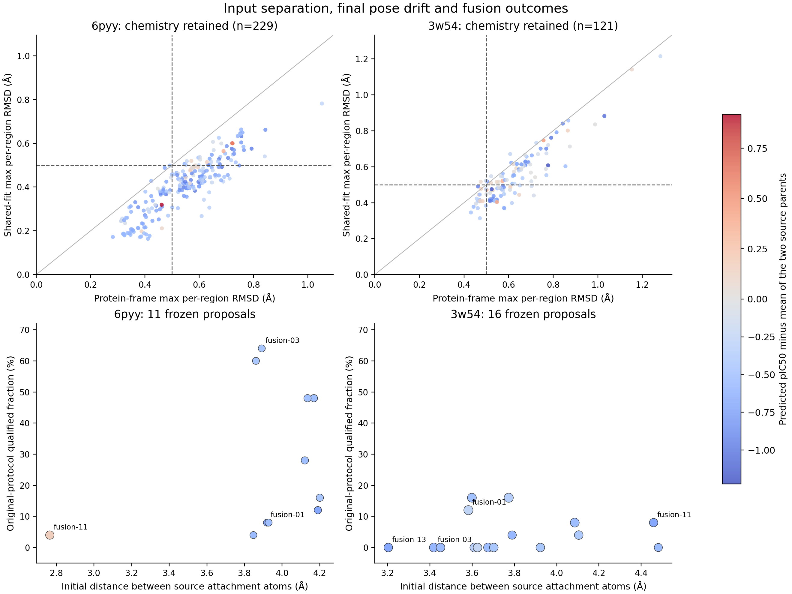

# 组合后pIC50下降：选区、三维关系与互作恢复诊断

本次重测27套输入条件、675条终态记录，其中493条可构建；没有新采样、没有新亲和力评分，也没有改写原实验合格标准。源运行提交为`fa1d2a258ba38aeb9466545c1b5de217b8d1e27b`。新测量绑定在[StatePacket](StatePacket.json)，原始完整结果见[上一份报告](../20261106_final/report.zh-CN.md)。

主要结论是：现有数据不支持把下降主要归结为两个选区太近。更明确的问题是选区删除了部分父本互作及其化学背景，实际终态仍允许条件漂移，且“合格融合”只要求每侧至少恢复一条互作。3w54还存在较多片段内部变形与化学改变。当前没有随机配对、同父本重建或末步设置的配对对照，不能唯一分配这些因素对评分下降的因果贡献。

**先明确比较对象。** 对每个终态，用其真实两个父本的平均pIC50作配对参照，再汇总差值。全部可构建分子的平均差值为：6pyy −0.4466，3w54 −0.4542；原协议合格子集分别为−0.5161和−0.2813。即使通过原几何/化学门槛，平均评分也没有超过父本。pIC50是本模型预测，不是本轮测得的活性。

## 当前程序和Agent实际上怎样选区

1. 归档中每靶点有100次unguided尝试。按node_id配对结构，完成统一端点重评分、基本化学/连接性/蛋白clash检查、PLIP和PB诊断。
2. LLM作化学审查，保留92/98与95/97个可构建来源姿态；程序按pIC50降序和化学拓扑去重，各取8父本。PB是诊断项。
3. 程序枚举切断一条或两条非环单键得到的子片段，保护完整环和预设官能团；片段必须包含真实PLIP接触及接触原子的至少一个原有重原子邻居。
4. Agent从注册片段中选两个不同父本的区域，说明互补性、基团完整性、接合可行性与不确定性。skills已有“考虑出口方向”的文字要求。
5. 程序拒绝选区间距离小于`0.75×两原子范德华半径之和`的严重重叠，保留原父本坐标。它没有证明一条化学和空间都可行的连接路径存在。
6. 自由原子数的下界主要由最近出口间距除以1.6Å估算，再结合父本大小、两个余量原子与±10%大小范围。不同父本固定原子之间保持无键，连接交给自由原子生成。
7. 运行native fragment-growing inpainting，`final_inpaint=false`。最终评价要求每侧至少一条原指纹互作、每侧蛋白坐标系RMSD<0.5Å，以及原有其他门槛。

程序给出了候选出口，却没有要求Agent选择“具体接哪两个出口、哪些切口允许封端、哪些新增连接被允许”。原有内部子图保留，不等于原有取代环境、电子背景和整个结合网络都保留。

## 选区是否过近

| 测量 | 6pyy（11方案） | 3w54（16方案） |
|---|---:|---:|
| 两侧所选原子的最近距离 | 2.69–4.20Å | 3.20–4.48Å |
| 最近连接出口间距 | 2.76–4.20Å | 3.20–4.48Å |
| 最近出口的原断键方向与对方出口方向夹角 | 11.2°–36.1° | 13.6°–38.0° |
| 跨区最小范德华归一化距离 | 0.813–1.235 | 0.942–1.318 |
| 未找到双方均朝向对方的出口对 | 0/11 | 0/16 |

因此没有发现普遍的严重初始重叠或出口背向。范德华阈值是粗筛，出口方向来自父本原断键，也不等于完整linker的可行性证明。真正需要检查的是连接价态、出口角度组合、原子数、绕行空间和可实现的连接构象，不能设置一个统一更大的片段距离就认为问题解决。

两个反例尤其直接：6pyy fusion-01与fusion-03的出口间距约3.92和3.89Å，却分别只有2/25和16/25合格；距离最短的fusion-11约2.76Å，反而是唯一可构建均值高于自身双亲均值的方案（+0.1521），虽然其原协议合格率只有1/25。当前小样本方案内描述性相关也没有呈现“越近平均pIC50越差”的一致趋势；这不能排除个别方案存在几何困难。

## 更明确的选区问题：保留了哪些特征，遗漏了哪些背景

6pyy前五个方案主要是“3原子羧酸根＋9原子吲哚”；接下来五个主要是“3原子羧酸根＋10原子氟代吲哚”。只有fusion-11把极性侧扩大为7原子的甲酰胺/羧酸根区域。11个方案实际上只有3种不同的固定片段拓扑，父本拓扑不同没有转化为充分的条件多样性。

选区保留的父本独特PLIP指纹覆盖率中位数仅为47.3%和56.3%。该计数不是能量权重，但说明组合并没有保留两个完整父本的结合网络。

**GLY152是值得验证的具体遗漏。** 6pyy的8父本中6个有GLY152受体氢键，但前10个方案都没有把该特征纳入固定条件。fusion-11保留的甲酰胺背景包含该特征。终态中，有该GLY152标签的46个可构建分子平均pIC50为4.1881，没有的195个为3.7416；在同时有/无该标签的8个方案中，6个呈正向组内差值。这个关联也受化学骨架、原子数及其他接触改变影响，不能当作该氢键能量或因果效应。

现有选择策略会保留单个羧酸根或芳环，却可能删除维持药效团空间位置、电子性质与另一条关键氢键的连接骨架。下一版应先评估完整高分父本的核心网络，再决定允许删除什么，而不是先收集可互补的局部标签。

**还发现一个可核验的Agent解释错误。** 3w54 fusion-03的`chemical_integrity`称保留了“brominated fused ring”，但实际固定子图不含Br。母体含Br，所选子片段已经删除它。当前审计能检查ID和证据绑定，却没有核验这些文字化学断言。应向Agent直接提供选中子图的“实际保留/删除原子、基团和互作”，并让结构化断言引用它们，减少从整个父本继承性质的错误。

## 相对构型失稳，还是整体位姿漂移

对条件化学仍保持的229个6pyy和121个3w54终态，只在固定对应原子上做一次两侧共同的proper Kabsch拟合，再分别检查两侧RMSD。没有反射、缩放、重新匹配或引入非condition区域。

| 化学保持子集的诊断 | 6pyy | 3w54 |
|---|---:|---:|
| 蛋白坐标系中任一侧RMSD≥0.5Å | 152 | 100 |
| 上述失败中，共同拟合后两侧均<0.5Å | 105/152 | 37/100 |
| 单侧内部拟合误差的最大值：中位数 | 0.168Å | 0.450Å |
| 跨区原子距离矩阵误差：中位数 | 0.378Å | 0.430Å |

6pyy相当一部分问题可由共同刚体移动解释，而不是两块区域之间彻底失去相对关系。3w54共同拟合后仍失败的比例更大，内部几何和相对构型变形更突出。不能仅用两侧合并的拟合均值：大区域会掩盖小区域误差，所以本诊断还分别检查共同拟合后的每一侧。

共同拟合只是诊断。它把配体相对蛋白的位姿变化消掉，不能据此改写原绑定空间评价或宣称互作仍成立。

上排只显示条件化学保持的终态；横轴为原蛋白坐标系误差，纵轴为两侧共同拟合后的最大单侧误差。下排每点是一个冻结方案；颜色为相对自身双亲均值的预测pIC50差，点大小随固定原子数变化。它们是描述性诊断，不是因果实验。

## 一个需要先控制的输出设置

冻结原生代码在每次Euler更新后对`curr`做inpainting，但最后默认再执行一次`final_corr_pred=True`的网络预测。只有`final_inpaint=True`才对这次`predicted`回填条件；当前为False，所以实际保存的是未经最终回填的预测。代码入口为`fm_pocket.py`的1777、1899和1919行。

这说明条件约束并未贯穿到实际输出，能解释“循环内固定，保存后却改变”的通道。它是本轮冻结设计，不能把事后回填当作旧协议原本已经成功。我们没有最后一步前的中间快照，因此不提供数值上的逐步分解，也不声称只改此开关就会提高pIC50。

下一版可用原生选项做明确对照：最终预测后回填条件，或者返回最后已回填的积分状态；随后对实际返回分子重新做完整几何、PB和pIC50评价。固定区域RMSD被强制恢复不代表接缝键长、键角和整体几何也正确。

## 现有“互作恢复”指标也需要细化

原评价只要求每个父本至少一个选区内原指纹出现，没有要求全部所选指纹恢复，也没有要求原接触原子完全相同。

| 原协议合格子集 | 6pyy | 3w54 |
|---|---:|---:|
| 原协议合格数 | 75 | 17 |
| 全部选中指纹均恢复 | 2/75 | 0/17 |
| 全部选中氢键指纹均恢复 | 74/75 | 8/17 |

这些数字必须按类型理解。6pyy合格子集的已选氢键恢复151/152条、盐桥75/75条、π堆积150/150条；疏水指纹146/186条，而F相关卤键指纹为0/39条。因而不能说其所有核心互作都消失了，也不应把所有PLIP标签等权设成硬目标。更关键的GLY152特征在多数方案中甚至没有被选入条件。

PLIP依赖化学分组和距离/角度规则，是结构型特征检测而非自由能分解。[PLIP原论文](https://pmc.ncbi.nlm.nih.gov/articles/PMC4489249/)。F能否作为卤键供体又依赖具体电子环境，不能由“有F且几何接近”直接推出可靠的强作用。[F-halogen bond的原始计算研究](https://pubs.acs.org/doi/10.1021/acs.jpca.0c06803)。本数据不足以判定某条F接触是假阳性，因此将其列为待复核、低确定性的候选特征。

切口也没有约束新增连接：条件化学保持子集中，6pyy的144/229、3w54的48/121个终态还在原切口以外的固定原子上连上了自由原子。这在旧协议中是允许的，不应事后称违规，但它会改变取代背景。3w54还有4个连通且条件化学保持的分子，其两侧连接没有经过原切口构成的桥。单纯保留固定原子及其内部键并不足以控制组合方式。

## 建议的Agent与程序分工

| 环节 | Agent负责的决定 | 程序应提供或保证的事实 |
|---|---|---|
| 主体选择 | 选可靠高分主骨架，明确需要保留的核心网络 | 父本PB、实际互作、完整图、评分及来源 |
| 片段取舍 | 说明保留、替代或放弃哪些候选锚点及理由 | 实际子图、丢失特征、共轭/取代/立体环境变化 |
| 组合方式 | 选择互补区域；重叠热点只保留一份或选择替换 | 已选片段和目标区域的去重、空间覆盖及冲突 |
| 接合选择 | 选择具体允许的端口及允许封端的边界 | 价态/键型、出口方向、多个连接长度与构象的可行性 |
| 条件恢复 | 指定少量必须恢复的核心特征及可替代特征 | 实际终态的坐标、化学、特征类型/几何、接缝与PB评价 |
| 后续取舍 | 根据实测反馈保留主体、换补充片段、回溯或放弃 | 真实终态pIC50及全部尝试分母，不用模型自评替代测量 |

**优先改进顺序：**

1. **建立主体保留策略。** 在完整父本层面找候选核心网络，再选片段。保留必要的相邻骨架、共轭和取代背景；把被删除的高一致性特征明确展示给Agent。不能仅以接触条数最大化选择。GLY152适合作为6pyy的优先验证锚点，而非已经证实必不可少的药效团。
2. **用可检验的接合方案代替一句“出口可接”。** 对允许端口、氢封端、键型和自由原子数形成约束，先做小型程序化连接/构象可行性检查，结合蛋白排斥体积。没有可行路线就换区域或放弃；不统一拉远片段，也不统一增加连接长度。DeLinker直接利用片段间距和相对方向，DiffLinker还使用三维片段及口袋条件并处理连接规模，这些是应借鉴的几何建模要点，而非必须更换本项目生成器。[DeLinker](https://pubs.acs.org/doi/10.1021/acs.jcim.9b01120)；[DiffLinker](https://www.nature.com/articles/s42256-024-00815-9)。
3. **核验终态条件闭环。** 对照原生末步选项，保留真实输出后再评分。把固定区、固定—自由接缝和自由区的几何分别报告，防止仅凭回填得到很低RMSD。
4. **按置信度恢复特征。** 将核心锚点与探索性接触分开，分别评价氢键供受体、带电中心、芳环位置/法向及疏水占据；同时报告相对完整父本和选中区域的覆盖率。对化学等价原子/位点提供合理组级诊断，而不是以严格原子标签不一致一概判失败。保持pIC50为完整终态的预测目标，不把碎片分数相加。
5. **把反馈和多样性绑定到实际条件。** 以选区图、关键特征与几何去重，而不是只按父本ID去重。保留多种有实测依据的连接/替换机会；根据“物理质量＋核心特征恢复＋相对父本评分”决定下一批选择。高分父本筛选本身没有使生成器直接优化pIC50，因此需要真正的测量反馈，不能预期任意互补片段自然相加获益。

FLOWR论文将multi用途训练与单纯生成模型区分，明确在条件训练中处理片段时间与固定互作原子。[FLOWR原论文](https://arxiv.org/html/2504.10564v2)。本轮ROOT checkpoint的条件训练元数据未保存在小体积证据包，补充SSH读取未成功；不能仅凭推理flag判断它等同于论文的MULTI模型，也不把训练不匹配宣布为已证实原因。应先验证ROOT上的原生控制和自体重建，再决定是否需要另测条件训练权重。

## 下一轮最有信息量的验证

先做同父本的“截取—重建”阳性对照：片段来自一个本来能形成完整分子的父本，原连接长度已知。如果该对照也丢失条件、PB或pIC50，应先定位生成/输出环节；如果自体重建可靠而跨父本失败，再集中处理跨区域兼容性。

随后用小规模配对设计，比较“当前选区／保留核心网络的选区”与“当前末步输出／保留终态条件的原生输出”。冻结口袋、评分器、总样本预算与种子，明确总原子数控制。评价全部尝试中的物理可用产率、核心特征恢复和相对父本pIC50；保留原有协议统计作对照。这样可以分辨选区问题与最后输出问题，避免同时改动很多因素后无法归因。本次没有启动这些实验。

新增接口与skills的[建议草案](workflow_proposal.md)只描述未来可审阅设计，尚未接入运行。

逐方案与逐终态测量见[region_geometry.csv](region_geometry.csv)、[terminal_geometry.csv](terminal_geometry.csv)；实际原子选择、出口坐标与Agent原理由见[selection_details.json](selection_details.json)。共同拟合、严格原子级接触和出口夹角均为新增诊断，没有改写原675次结果或重新计算其合格标签。
